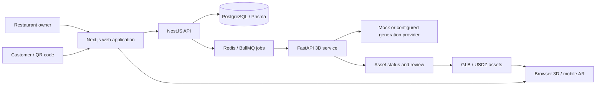

# MenuAR — Restaurant Menus in 3D / AR

**Next.js · React · TypeScript · NestJS · PostgreSQL · Prisma · Redis / BullMQ · FastAPI · model-viewer · GLB / USDZ**

MenuAR explores a practical restaurant workflow: owners manage meals and add-ons, customers scan a QR code, and approved assets connect a browser menu to a 3D/AR viewing experience.

**Status:** Local development prototype. Source is kept private during release review. This page is an engineering overview; a public deployment and physical-device AR acceptance are not claimed.

## Product journey

1. A restaurant owner adds a meal, price, description, photos, and optional add-ons.
2. Uploaded or generated 3D assets pass through status and review controls.
3. A customer scans the restaurant QR code and opens the browser menu.
4. A meal page displays available approved assets through `model-viewer`.
5. Supported phones can continue into Android Scene Viewer or iOS Quick Look; actual compatibility requires HTTPS and device testing.

## Architecture

## Implemented source areas

| Area | Source scope |
| --- | --- |
| Owner interface | Meal and add-on management, photo upload, QR pages, orders, and settings |
| Customer interface | Restaurant menu, meal details, add-ons, cart, checkout, and model-viewer integration |
| API and data | NestJS modules, Prisma schema, local storage, and job/worker boundaries |
| Internal operations | Asset, generation, composition, and quality-review screens |
| 3D service | FastAPI job endpoints, mock/provider adapters, and composition/conversion boundaries |

The presence of a route or adapter describes source coverage, not end-to-end production verification. Provider calls require separately configured accounts, credentials, and budgets. Mock output demonstrates the workflow rather than production-quality food reconstruction.

## Engineering focus

- Keep model-generation details in internal operations so the owner journey stays simple.
- Connect asynchronous generation jobs to reviewable asset states.
- Keep customer-facing assets separate from unapproved candidates.
- Share TypeScript contracts across web and API workspace packages.
- Make GLB/USDZ and mobile-device requirements explicit.

## Verification still needed before a public release

- Fresh-install builds, authenticated API journeys, and authorization review.
- Physical Android/iPhone tests over HTTPS with approved assets.
- Provider failure/retry behavior, model scale/orientation, and file-size checks.
- Deployment, storage, and operational readiness review.

[Back to my portfolio](../README.md)
