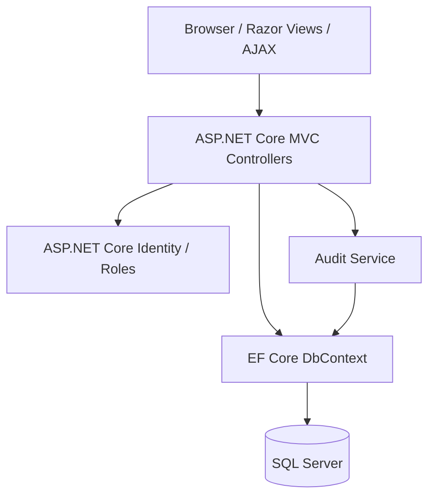

# Smart Booking System — ASP.NET Core MVC

**C# · ASP.NET Core MVC (.NET 8) · Entity Framework Core · SQL Server · ASP.NET Core Identity · Docker · GitHub Actions**

An academic training-center booking application with server-rendered MVC, role-based access, conflict-aware scheduling, and tested account recovery.

> **Source availability:** The source remains private. This engineering overview describes verified local work; it is not a public source release or hosted demo.

## Core user flows

- **User:** Register, confirm an account, sign in, reset a password, choose a service/coach/slot, and book or cancel an appointment.
- **Coach:** Manage availability and view assigned appointments.
- **Admin:** Manage services, coaches and schedules, review bookings, and inspect audit records.

## Architecture at a glance

## Engineering decisions

1. **Protect bookings during schedule changes.** Bookings and schedule mutations acquire the same transaction-owned coach lock. Overlapping schedules and edits that would strand future appointments are rejected; audit records commit with the change.
2. **Enforce permissions on the server.** Role checks, anti-forgery validation and explicit posted-field allowlists protect administration workflows.
3. **Test actual account recovery.** Integration tests exercise Identity confirmation, cookie login, password-reset tokens and replay rejection using captured test mail.
4. **Make production configuration explicit.** Confirmed accounts, allowed hostnames, persistent Data Protection keys, STARTTLS mail settings and trusted proxies are configured deliberately. Production migrations and seeding are opt-in.

## Verification

On **October 19, 2026**, **30 tests passed locally with no skipped cases** on .NET 8.0.32 against newly created SQL Server LocalDB test databases:

| Coverage | Evidence |
| --- | --- |
| SQL Server / HTTP integration | 14 cases, including booking and schedule races, ownership and actual Identity flows |
| Unit / configuration checks | 16 cases covering validation and security/configuration contracts |
| Build and container delivery | GitHub Actions CI and Docker build passed for the reviewed release |
| Dependency review | NuGet reported no vulnerable entries at verification time; browser dependencies updated from integrity-verified upstream packages |

These results cover the tested scenarios, not every production workload. The mail tests capture messages in memory; real SMTP delivery has not been verified.

## Current status

| Area | Status |
| --- | --- |
| MVC application, database model and role workflows | Implemented in private source |
| Booking / schedule concurrency | Covered by SQL Server integration tests |
| Registration, confirmation and password recovery | Covered by actual Identity HTTP tests |
| Local product screenshots | Captured with synthetic demonstration data |
| Public runnable source or hosted demo | Not available |
| Production release | Still requires deployment-specific validation and completion of the deferred credential/history review |

No private credentials or customer data are included in this overview.

[Back to my GitHub portfolio](../README.md)
