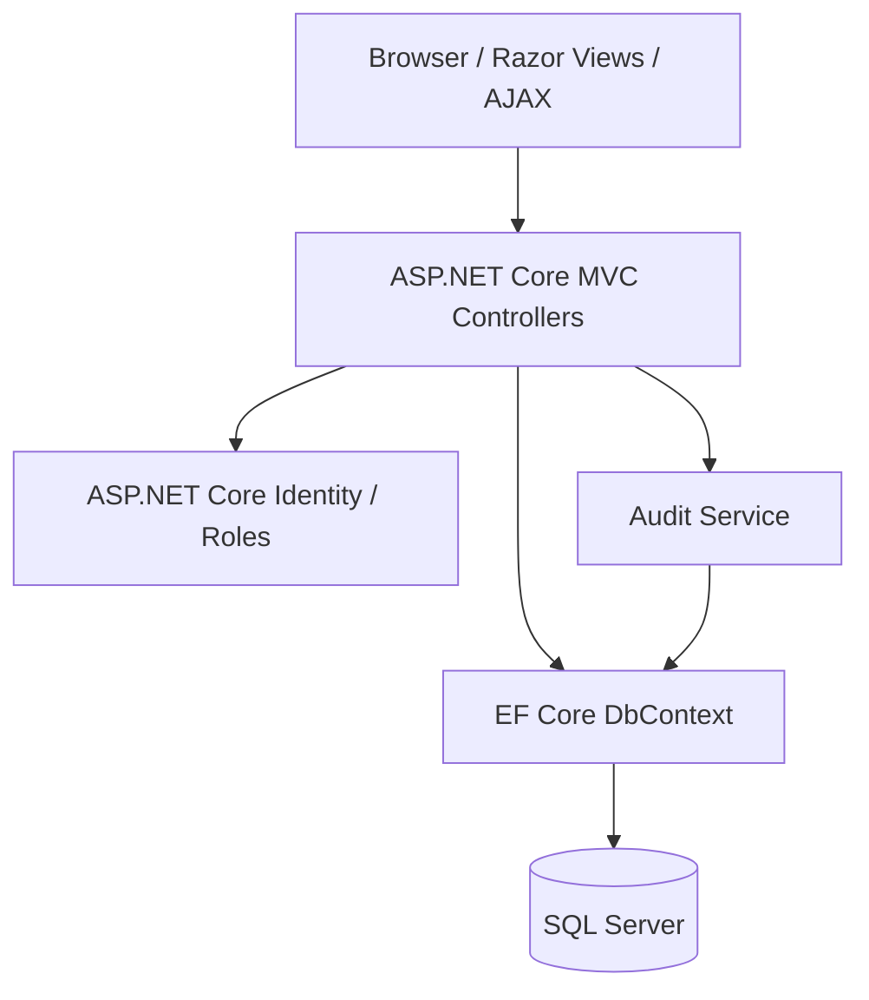

# Smart Booking System — ASP.NET Core MVC

**C# · ASP.NET Core MVC (.NET 8) · Entity Framework Core · SQL Server · ASP.NET Core Identity · Docker · GitHub Actions**

An academic training-center booking project demonstrating server-rendered MVC, database modeling, role-based access, scheduling, and AJAX updates.

> **Source availability:** The source repository is private while security and Git-history review continue. This page is an engineering overview, not a public code release or hosted demo.

## Core user flows

- **User:** Choose a service, coach, date and available slot; book, view, and cancel appointments.
- **Coach:** Manage schedule and view assigned appointments.
- **Admin:** Manage services and coaches, review bookings, and inspect audit records.

## Architecture at a glance

## Engineering challenges

1. **Role boundaries:** Different operations require different permissions; authorization must be enforced server-side, not only by hidden UI links.
2. **Booking conflicts:** Slot availability depends on coach schedules and existing appointments; true simultaneous booking remains a database-concurrency consideration.
3. **Data consistency:** Entity Framework Core migrations and domain models provide the data layer; controlled development seeding supports demonstrations.
4. **Quality and security:** The private project has a .NET CI workflow and a small targeted test suite for model validation and authorization attributes. This does **not** establish full integration coverage or production readiness.

## Honest project status

| Area | Status |
| --- | --- |
| MVC application and database model | Implemented in private source |
| Admin / Coach / User flows | Implemented in private source |
| GitHub Actions build and Docker image checks | Configured in private source |
| Automated unit/attribute tests | Added; CI validation required for latest changes |
| Public runnable source or live demo | Not available |
| Database-backed integration and concurrency testing | Still needs expansion |
| Public release | Pending source/history security review |

A reviewed screenshot or local demonstration may be added after verifying no private data is visible. No fictional demo, test result, or public URL is presented here.

[Back to my GitHub portfolio](../README.md)
